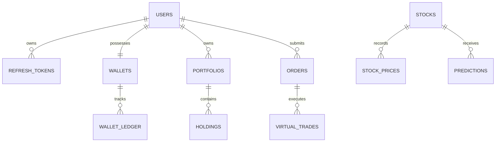

# SmartStock AI — Database Schema Specification

## Database Engine: PostgreSQL 16+

All monetary amounts are strictly represented in integer paise (`50000 paise = ₹500.00`) to guarantee transaction safety and auditability.

## Primary Domain Entities

### `users`
- `id`: UUID (PK)
- `email`: VARCHAR(255) (UNIQUE, indexed)
- `hashed_password`: VARCHAR(255)
- `full_name`: VARCHAR(255)
- `is_active`: BOOLEAN
- `is_verified`: BOOLEAN
- `created_at`: TIMESTAMPTZ
- `updated_at`: TIMESTAMPTZ

### `wallets`
- `id`: UUID (PK)
- `user_id`: UUID (FK -> users.id, UNIQUE)
- `balance_paise`: BIGINT (NOT NULL, DEFAULT 50000)
- `currency`: VARCHAR(10) (DEFAULT 'INR')
- `created_at`: TIMESTAMPTZ
- `updated_at`: TIMESTAMPTZ

### `wallet_ledger`
- `id`: UUID (PK)
- `wallet_id`: UUID (FK -> wallets.id)
- `amount_paise`: BIGINT (Positive for credit, negative for debit)
- `balance_before_paise`: BIGINT
- `balance_after_paise`: BIGINT
- `transaction_type`: VARCHAR(50) (DEMO_CREDIT, VIRTUAL_BUY, VIRTUAL_SELL, PAYMENT_DEPOSIT)
- `reference_id`: VARCHAR(255)
- `created_at`: TIMESTAMPTZ

### `stocks`
- `symbol`: VARCHAR(20) (PK)
- `company_name`: VARCHAR(255)
- `exchange`: VARCHAR(50)
- `sector`: VARCHAR(100)
- `is_active`: BOOLEAN
- `created_at`: TIMESTAMPTZ

### `orders`
- `id`: UUID (PK)
- `user_id`: UUID (FK -> users.id)
- `symbol`: VARCHAR(20) (FK -> stocks.symbol)
- `order_type`: VARCHAR(20) (BUY / SELL)
- `quantity`: INTEGER
- `price_paise`: BIGINT
- `status`: VARCHAR(20) (PENDING, FILLED, CANCELLED)
- `created_at`: TIMESTAMPTZ
